# 💧 SprinklerID (by IntelliDwell) — 10-Zone ESP32 Smart Sprinkler Controller Firmware

<p align="center">
  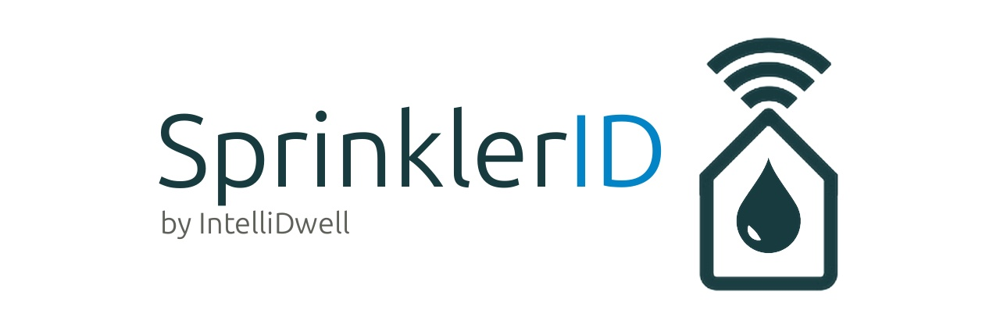
</p>

> **“SprinklerID identifies your irrigation needs—without needing to identify YOU. Total local control with your privacy in mind. SprinklerID, SprinklerIntelliDwell.”**

This repository contains the official open-source MicroPython firmware (`v2.1.28`) for **SprinklerID by IntelliDwell**, developed by Tanner Nelson. It runs on dual-core ESP32 microcontrollers and provides a fast, local-first web console (`http://sprinklers.local`), per-zone cycle-and-soak scheduling, sequential multi-zone queues, official **HACS Home Assistant** & **MQTT Auto-Discovery** integration, smart multi-source weather rain-delay automation, an optional Cloud & 2D Yard Map bridge (`https://sprinklers.intellidwell.net`), and a companion **Android App** (Local-Only & Cloud modes, with iOS coming soon).

---

## 🔗 Quick Links

* **Hardware & Product Page:** [https://www.intellidwell.net/sprinklercontroller](https://www.intellidwell.net/sprinklercontroller)
* **Official Documentation & API Guide:** [https://docs.intellidwell.net/sprinkler/](https://docs.intellidwell.net/sprinkler/)
* **Download Android Companion App (`.APK`):** [https://www.intellidwell.net/static/SprinklerID.apk](https://www.intellidwell.net/static/SprinklerID.apk)
* **Optional Cloud & 2D Yard Map Portal:** [https://sprinklers.intellidwell.net](https://sprinklers.intellidwell.net)

---

## 🚫 Licensing and Usage

This project is licensed under the [GNU General Public License v3 (GPLv3)](https://www.gnu.org/licenses/gpl-3.0.en.html), **with additional restrictions on commercial use of this code in hardware products**.

### In Plain English:
* ✅ **You can** view, modify, and run the code for personal projects.
* ✅ **You can** fork the project and share improvements (as long as they remain open-source under the GPLv3).
* ❌ **You may NOT** manufacture, sell, or distribute hardware products that use this code or its derivatives without express written permission from the author.

If you are interested in commercial licensing, please contact Tanner Nelson at [tanner.nelson@intellidwell.net](mailto:tanner.nelson@intellidwell.net).

---

## 📺 Web Console & Home Assistant Integration

The controller hosts a responsive dark-mode web console directly on the ESP32 (`http://sprinklers.local`), allowing seamless management from any browser on your local network alongside our mobile app and Home Assistant.

<p align="center">
  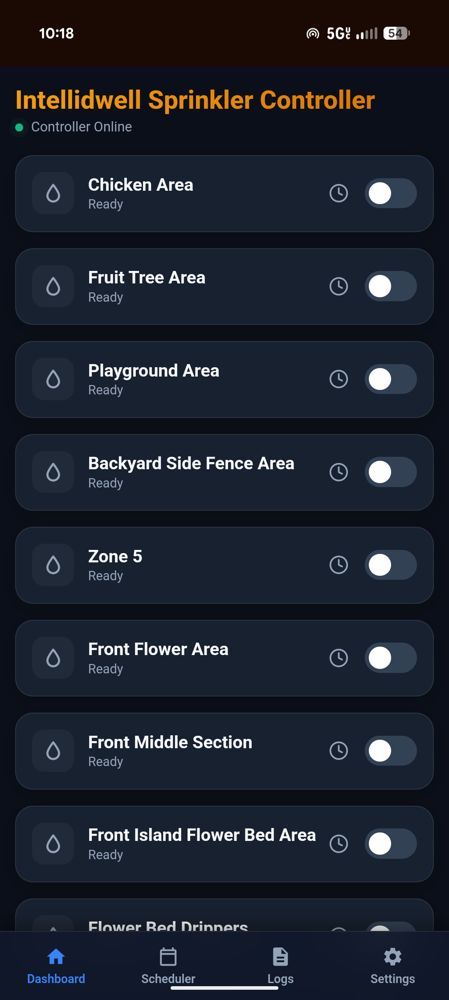
  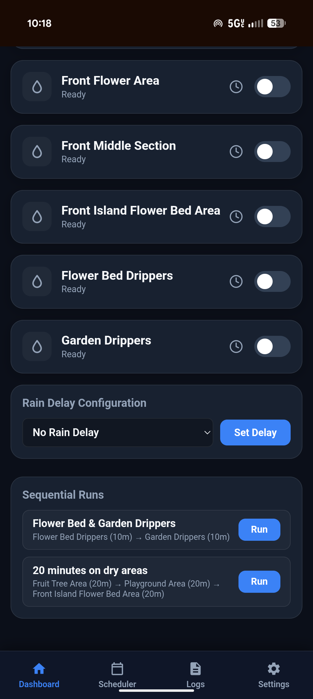
</p>
<p align="center">
  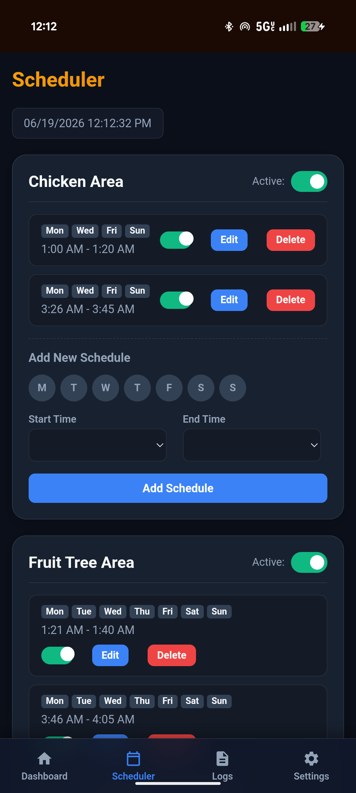
  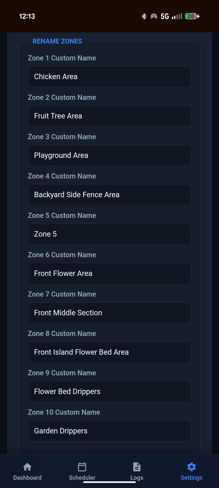
</p>
<p align="center">
  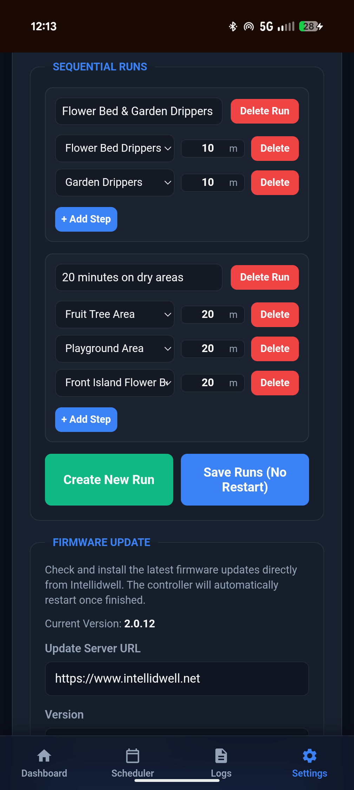
  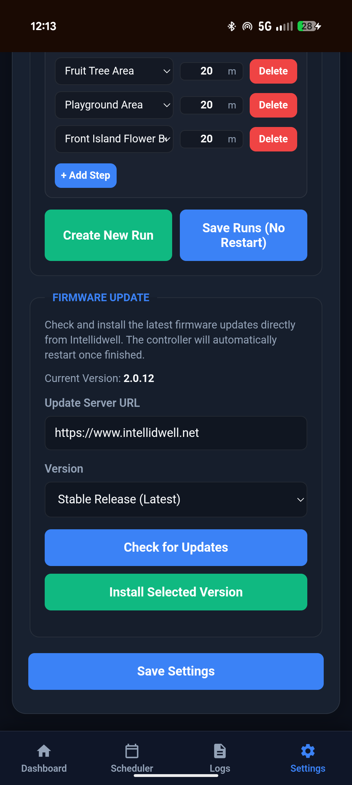
</p>

---

## 🔧 Features & Architecture (`v2.1.28`)

* **10-Zone Control + Master Valve**: Controls up to 10 independent 24VAC zone solenoids with a configurable Master Valve / Pump Relay and a 1000ms pre-open interlock delay to prevent water hammer and current brownouts.
* **100% Local-First (No ID Required)**: Operates autonomously on your local Wi-Fi network (`http://sprinklers.local`) and via the **SprinklerID Mobile App** in **Local-Only Mode**—no account registration or internet connection required.
* **Optional Cloud Bridge & Interactive 2D Yard Map**: Pair with [sprinklers.intellidwell.net](https://sprinklers.intellidwell.net) over an outbound WebSocket (`cloud.py`) for remote control without port forwarding, multi-property/contractor sharing, and an interactive **2D CAD Yard Map** with AI satellite scanning and live rotor/dripper animations.
* **Official HACS Home Assistant Integration & Native MQTT**: Supports both our custom local HACS integration (`ha-intellidwell`) and built-in MQTT Home Assistant Auto-Discovery.
* **Smart Multi-Source Weather & Rain Delay Arbitration (`ha_rain_delay`)**:
  * When Cloud Services are disabled (`cloud_enabled == 0`), the controller automatically applies rain delays pushed by Home Assistant (`POST /api/weather`).
  * When Cloud Services are enabled (`cloud_enabled == 1`), the Cloud Server syncs `ha_rain_delay` (`0` when using **Ambient Weather Network** or **NWS** stations; `1` when using **Controller Pushed / Home Assistant**) so Home Assistant telemetry (`temp`, `rain_today_in`) is recorded without overwriting your Cloud weather station's rain delay.
* **ESP-IDF Internal C DRAM Protection & Zero-Regex Routing**: Optimized Microdot HTTP/WebSocket framing and `mpy-cross -O3` bytecode compilation keep ESP-IDF internal C DRAM healthy (`>26 KB` free) during concurrent Local UI, Home Assistant polling, and Cloud WebSocket operation.
* **Long-Range 20MHz 802.11b + Strongest-BSSID Roaming**: Automatically scans 2.4GHz mesh networks and pins association to the strongest BSSID in `network.MODE_11B` (`pm=0`, `txpower=15`), eliminating OFDM rate-collapse stalls at weak outdoor RSSI (`-75` to `-80 dBm`).
* **1-Click Over-The-Air (OTA) Updates**: Pull Stable (`master`) or Beta (`beta`) firmware updates directly from the device Settings page.

---

## 📦 Enclosure & Hardware Layout

The V2 architecture separates the 24VAC wall transformer from the low-voltage enclosure, featuring a low-profile wall-mount casing with a magnetic quick-access faceplate.

<p align="center">
  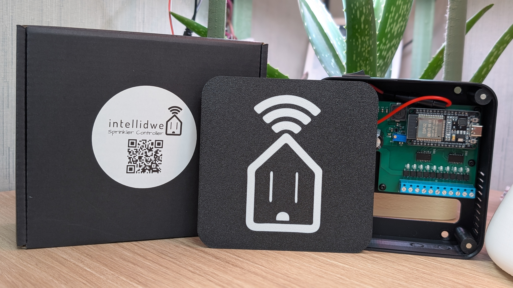
  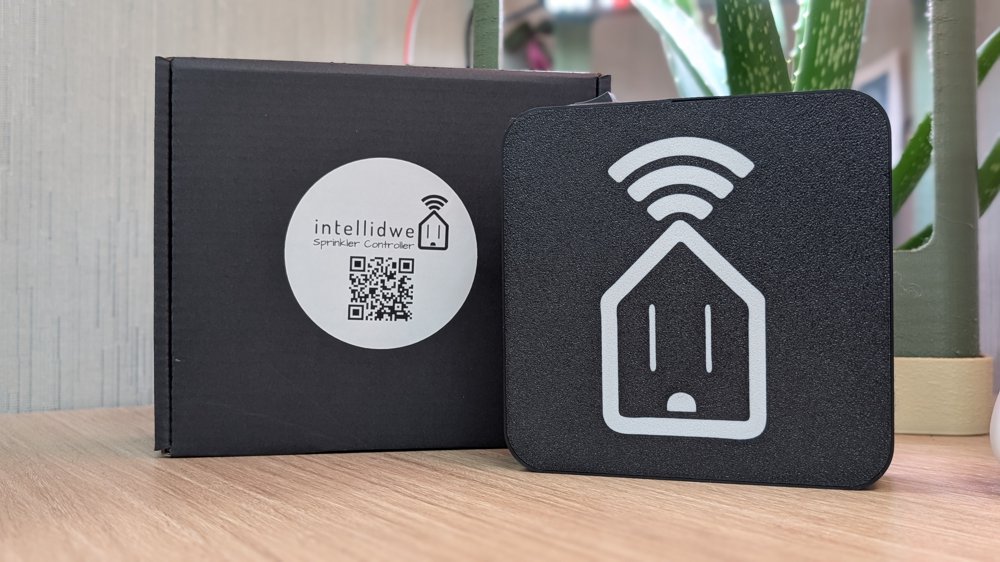
</p>
<p align="center">
  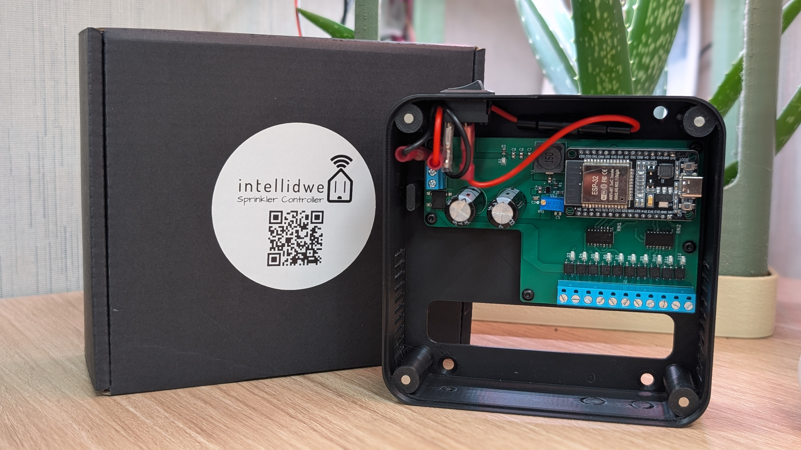
  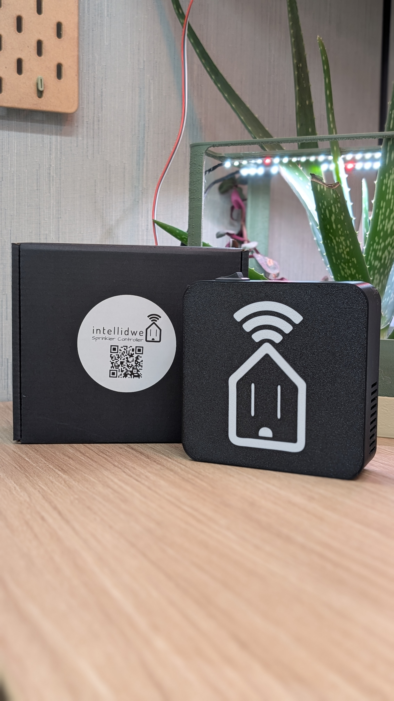
</p>

---

## 🚀 Flashing & Installation Guide

### 1. Flash MicroPython onto the ESP32
```bash
pip install esptool
esptool.py --chip esp32 --port /dev/ttyUSB0 erase_flash
esptool.py --chip esp32 --port /dev/ttyUSB0 --baud 460800 write_flash -z 0x1000 ESP32_GENERIC-latest.bin
```

### 2. Compile (`.mpy`) & Upload Firmware Files
For optimal ESP32 RAM headroom, precompile the core modules with `mpy-cross -O3` before uploading:
```bash
pip install mpy-cross mpremote

mpy-cross -O3 -s microdot.py -o microdot.mpy microdot.py
mpy-cross -O3 -s microdot_asyncio.py -o microdot_asyncio.mpy microdot_asyncio.py
mpy-cross -O3 -s cloud.py -o cloud.mpy cloud.py
mpy-cross -O3 -s controller.py -o controller.mpy controller.py

mpremote connect /dev/ttyUSB0 cp main.py controller.mpy cloud.mpy microdot.mpy microdot_asyncio.py index.html scheduler.html logs.html settings.html settings.json :
```

### 3. Initial Wi-Fi Configuration
1. Reboot the controller board.
2. Connect to the temporary Wi-Fi access point **`intelidwellSC`** (password **`Sprinkler12345`**).
3. Open `http://192.168.4.1`, select your 2.4GHz Wi-Fi network, and click **Connect**.
4. Access the dashboard at **`http://sprinklers.local`** (or via the **SprinklerID** mobile app).

---

## 💻 Local REST API Endpoints

* **`GET /api/status`**: Returns JSON telemetry (`firmware_version`, `relay_states`, active `timers`, sequential `queue`, and latest `weather` push).
* **`GET /relay/<zone_index>/<on_or_off>`**: Toggles a zone manually (`0–9`).
* **`GET /relay-timer/<zone_index>/<duration_minutes>`**: Starts a timed zone run (`1–240` minutes).
* **`GET /cancel-timer/<zone_index>`**: Stops active watering and cancels timers.
* **`POST /start-run-queue` / `POST /stop-run-queue`**: Starts or stops a multi-zone sequential run queue.
* **`GET /get-schedules` / `POST /add-schedule/<pin>` / `POST /edit-schedule/<pin>/<id>`**: Reads or updates on-device zone schedules.
* **`GET /set-rain-delay/<days>` / `GET /get-rain-delay`**: Sets or reads the active rain delay (`0–5` days).
* **`POST /api/weather`**: Pushes local weather telemetry (`rain_today_in`, `temp`, `source`, `delay_days`) from Home Assistant.
* **`GET /api/cloud/status` / `POST /api/cloud/login`**: Queries or pairs the optional Cloud WebSocket bridge.
* **`POST /ota/pull?version=beta` / `GET /ota/status`**: Triggers and monitors an Over-The-Air firmware update.

---

## 🤝 Support & Contribution

Official hardware kits, documentation, and support are available at [intellidwell.net](https://www.intellidwell.net/sprinklercontroller) and [docs.intellidwell.net](https://docs.intellidwell.net/sprinkler/). For inquiries, contact [support@intellidwell.net](mailto:support@intellidwell.net).
